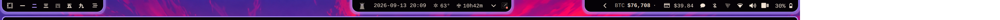

# Glowing Island Bar

[](preview.png)

A full-bar replacement for the Omarchy Quickshell status bar. Instead of one
continuous strip, every bar section draws itself as a rounded **island** with a
soft glowing border, and the space between islands stays fully transparent so
the wallpaper shows through. Each island is welded to the top of the screen and
grows or shrinks smoothly as widgets appear (the tray opens, the center section
reveals extra items, and so on).

- **Per-section islands** — left, center, and right each get one rounded
  background. No per-icon pills, no full-width slab.
- **Glowing border** — a thin accent border plus a blurred accent halo. The
  colors follow the active theme (`Color.accent`) and update live when you
  switch themes.
- **Docked to the edge** — the attached side overshoots the screen edge, so
  there is no hairline gap between the island and the top of the monitor.
- **Animated** — islands ease to their new size and position when the layout
  changes, so the backing never pops or clips.

## Install

```bash
omarchy plugin add https://github.com/crueber/omarchy-glowing-island-bar.git --enable
```

The manifest carries `omarchy.clonedFrom: "omarchy.bar"`, so enabling it takes
over the built-in bar. Your existing `bar.layout` in
`~/.config/omarchy/shell.json` is preserved — only the rendering changes.

### Removal

```bash
omarchy plugin remove crueber.glowingislandbar
```

Removing the plugin restores the stock `omarchy.bar`. You can also switch back
manually at any time:

```bash
omarchy bar use omarchy.bar
```

Requires Omarchy Quattro with the Quickshell shell.

## Tuning

Islands are configured under `bar.islands` in `~/.config/omarchy/shell.json`.
These values hot-reload, so no shell restart is needed:

```json
"bar": {
  "islands": {
    "enabled": true,
    "attach": true,
    "attachOvershoot": 2,
    "padding": 4,
    "innerPadding": 4,
    "radius": -1,
    "barSize": 0,
    "borderWidth": 1,
    "glow": true,
    "glowRadius": 2,
    "glowIntensity": 0.6,
    "animationMs": 180
  }
}
```

| Key | Default | Effect |
| --- | --- | --- |
| `enabled` | `true` | Turn islands on/off |
| `attach` | `true` | Weld the island to the screen edge (square corners there) |
| `attachOvershoot` | `2` | Pixels the attached edge overlaps the screen edge |
| `padding` | `4` | Gap on the along-bar ends of each island |
| `innerPadding` | `4` | Gap on the desktop-facing side (bottom for a top bar) |
| `radius` | `-1` | Corner radius; `-1` = full pill |
| `barSize` | `0` | Override bar height in px; `0` = follow the theme |
| `borderWidth` | `1` | Border thickness |
| `glow` | `true` | Draw the halo |
| `glowRadius` | `2` | Halo spread in px |
| `glowIntensity` | `0.6` | Halo opacity |
| `animationMs` | `180` | Resize/position easing duration |
| `borderColor` / `glowColor` | theme accent | Optional fixed colors; leave out to follow the theme |

Structural edits to `Bar.qml` need `omarchy restart shell`; `shell.json` changes
apply live.

## Marketplace listing

- **Category:** Appearance
- **Tags:** `bar`, `hyprland`, `quickshell`
- **Repository:** <https://github.com/crueber/omarchy-glowing-island-bar>

## Files

- `Bar.qml` — the bar engine (modified from Omarchy's `plugins/bar/Bar.qml`)
- `BarModel.js` — layout/settings helpers (unmodified)
- `preview.png` — screenshot of the islands

## License

[MIT](LICENSE) — includes code derived from Omarchy's first-party
`omarchy.bar` plugin.
